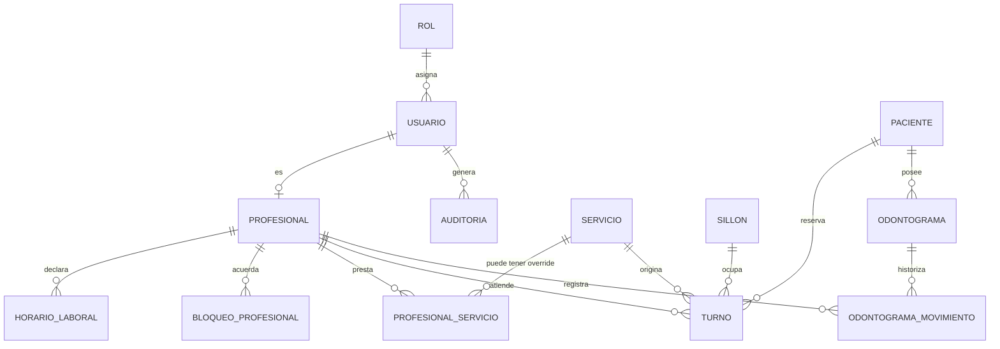

# Modelo de Datos

## Dominios

El modelo se organiza en cuatro dominios. Cada dominio agrupa entidades que comparten invariantes y reglas.

| Dominio | Descripción | Entidades |
|---|---|---|
| **Identidad y acceso** | Quién entra al sistema y con qué permisos | `Rol`, `Usuario`, `Auditoria` |
| **Maestros de la clínica** | La estructura de la clínica: quién atiende, qué hace, dónde y cuándo | `Profesional`, `Servicio`, `ProfesionalServicio`, `Sillon`, `HorarioLaboral`, `Feriado`, `BloqueoProfesional` |
| **Agenda** | El núcleo del sistema: pacientes y turnos | `Paciente`, `Turno` |
| **Odontograma** | La ficha mínima por pieza dental | `Odontograma` (una fila por paciente y pieza), `OdontogramaMovimiento` |

> **Convención de nombres**: tablas en `snake_case` y en **singular** (`turno`, `paciente`), columnas en `snake_case`, claves primarias `id` de tipo `BIGINT` generado (`GENERATED ALWAYS AS IDENTITY`). Los nombres de los enums van en `UPPERCASE` para poder referenciarlos como tipo en PostgreSQL.

---

## ERD (Entity Relationship Diagram)

### Diagrama general



### Diagrama de relaciones principal

```
                          ┌──────────┐
                          │   ROL    │
                          └────┬─────┘
                               │ 1
                               │
                          ┌────▼─────┐            ┌──────────────┐
                          │ USUARIO  │──1:1──────▶│ PROFESIONAL  │
                          └────┬─────┘            └──────┬───────┘
                               │ 0..N                    │
                               │ (actor)                │ 1
                          ┌────▼─────┐                   │
                          │AUDITORIA │            ┌──────▼───────────┐
                          └──────────┘            │ HORARIO_LABORAL  │  (0..N ventanas
                                                 └──────────────────┘   por día de semana)
                                                            │
                                                            │ 1
                                                 ┌──────────▼──────────┐
                                                 │ BLOQUEO_PROFESIONAL │  (vacaciones, congressos)
                                                 └─────────────────────┘

  ┌────────────┐         ┌──────────────────┐         ┌───────────┐
  │  SERVICIO  │◀───N:M──│PROFESIONAL_SERV.│─────N:1─▶│PROFESIONAL│
  │ (duración  │         │ (override de     │         └───────────┘
  │   base)    │         │  duración)       │
  └─────┬──────┘         └──────────────────┘
        │ 1
        │
        │ N                    ┌─────────────┐
        └─────────────────────▶│   TURNO     │◀────────────┐
                                └──────┬──────┘             │
                                       │ N                 │ N
                    ┌──────────────────┼──────────┐       │
                    │ 1                │ 1        │ 1     │
               ┌────▼────┐      ┌──────▼─────┐  ┌─▼─────┐ │
               │ PACIENTE│      │PROFESIONAL │  │SILLON │ │
               └────┬────┘      └────────────┘  └───────┘ │
                    │ 1                                   │
                    │ N                                   │
             ┌──────▼────────┐                            │
             │  ODONTOGRAMA │  (odontograma: 1 fila      │
             │  11..48       │   por pieza y paciente)    │
             └──────┬────────┘                            │
                    │ 1                                   │
                    │ N                                   │
             ┌──────▼───────────────────┐                 │
             │ ODONTOGRAMA_MOVIMIENTO   │                 │
             │ (historial append-only)  │                 │
             └──────────────────────────┘                 │
                                                        │
             ┌───────────┐                                │
             │  FERIADO  │  (día completo, clínica-wide)│
             └───────────┘                                │
                                                        │
   ┌─────────────────────────────────────────────────────▼──┐
   │                    RESTRICCIONES DE EXCLUSIÓN            │
   │  turno_no_solape_profesional  (profesional_id + [inicio,fin) )  │
   │  turno_no_solape_paciente     (paciente_id    + [inicio,fin) )  │
   │  turno_no_solape_sillon       (sillon_id      + [inicio,fin) )  │
   └────────────────────────────────────────────────────────┘
```

> **Nota**: `Feriado` y `Sillon` no tienen relación directa con `Turno`. Se conectan por **restricción de negocio**, no por foreign key: un turno no puede caer en un feriado (RN-FE-03) ni usar un sillón inactivo (RN-SI-04), pero la base de datos no puede expresar esas reglas sólo con FKs. La duración de la ventana y el concepto de "ocupa el sillón durante `[inicio, fin)`" es lo que sí se expresa en la base, mediante índices GiST parciales.

---

## Entidades

### `rol` — Catálogo de roles

| Columna | Tipo | Null | Notas |
|---|---|---|---|
| `id` | `SMALLINT` | no | PK |
| `nombre` | `VARCHAR(32)` | no | UNIQUE. Valores: `SECRETARIA`, `ODONTOLOGO`, `ADMIN` |
| `descripcion` | `VARCHAR(255)` | sí | Texto legible |
| `activo` | `BOOLEAN` | no | DEFAULT `TRUE` |

- **Relaciones**: 1 → N `usuario`.
- **Constraints**: `UNIQUE(nombre)`.
- **Seed**: 3 filas.
- **Nota**: el rol es **dato**, no código. Se implementa como tabla para que agregar un cuarto rol sea un `INSERT` y no una migración de código. **No hay interfaz de gestión de roles** (DD-13).

---

### `usuario` — Identidad de acceso y sujeto del JWT

| Columna | Tipo | Null | Notas |
|---|---|---|---|
| `id` | `BIGINT` | no | PK. Es el claim `sub` del JWT |
| `rol_id` | `SMALLINT` | no | FK → `rol.id` |
| `email` | `VARCHAR(255)` | no | UNIQUE. Es el identificador de login |
| `password_hash` | `VARCHAR(255)` | no | **bcrypt**. Nunca texto plano |
| `nombre_completo` | `VARCHAR(255)` | no | Para mostrar en la interfaz y en la auditoría |
| `activo` | `BOOLEAN` | no | DEFAULT `TRUE` |
| `ultimo_acceso` | `TIMESTAMPTZ` | sí | Se actualiza en cada login |
| `created_at` / `updated_at` | `TIMESTAMPTZ` | no | Automáticos |

- **Relaciones**: N → 1 `rol`; 1 → 0..1 `profesional` (relación 1:1 opcional).
- **Constraints**: `UNIQUE(email)`; `CHECK (rol_id <> 0)` implícito por FK.
- **Índices**: `UNIQUE(email)`, `INDEX(rol_id)`, `INDEX(activo)`.
- **Nota**: el email identifica al usuario pero **no es dato de contacto de un paciente**. Los datos de salud viven exclusivamente en `paciente` y `odontograma`.

---

### `profesional` — Odontólogo

| Columna | Tipo | Null | Notas |
|---|---|---|---|
| `id` | `BIGINT` | no | PK |
| `usuario_id` | `BIGINT` | sí | UNIQUE, FK → `usuario.id`. NULL mientras el `admin` no le haya creado la cuenta (RN-PR-01) |
| `nombre_completo` | `VARCHAR(255)` | no | Se replica del usuario para las consultas de agenda |
| `especialidad` | `VARCHAR(120)` | sí | Texto libre. No es catálogo en el MVP |
| `matricula` | `VARCHAR(64)` | sí | Opcional |
| `color_agenda` | `VARCHAR(7)` | sí | `#RRGGBB`, para distinguir columnas en la agenda |
| `activo` | `BOOLEAN` | no | DEFAULT `TRUE` |
| `created_at` / `updated_at` | `TIMESTAMPTZ` | no | Automáticos |

- **Relaciones**: 1 → 0..1 `usuario` (1:1 opcional: la `secretaria` da de alta al profesional y el `admin` le crea la cuenta); 1 → N `horario_laboral`, `bloqueo_profesional`, `turno`, `profesional_servicio`.
- **Constraints**: `UNIQUE(usuario_id)`, `CHECK (color_agenda ~ '^#[0-9A-Fa-f]{6}$')` cuando no es nulo.
- **Índices**: `UNIQUE(usuario_id)`, `INDEX(activo)`.
- **RN aplicadas**: RN-PR-01, RN-PR-05, RN-AU-05.

---

### `servicio` — Catálogo de prácticas

| Columna | Tipo | Null | Notas |
|---|---|---|---|
| `id` | `BIGINT` | no | PK |
| `nombre` | `VARCHAR(120)` | no | UNIQUE (entre activos) |
| `duracion_min` | `SMALLINT` | no | RN-PR-02. Valores permitidos: 15, 30, 45, 60 |
| `descripcion` | `VARCHAR(500)` | sí | Se muestra en el detalle del turno |
| `activo` | `BOOLEAN` | no | DEFAULT `TRUE` |
| `created_at` / `updated_at` | `TIMESTAMPTZ` | no | Automáticos |

- **Relaciones**: 1 → N `turno`; N ↔ M `profesional` (vía `profesional_servicio`).
- **Constraints**: `CHECK (duracion_min IN (15, 30, 45, 60))`; índice único parcial `UNIQUE(nombre) WHERE activo`.
- **Índices**: `INDEX(activo)`.
- **RN aplicadas**: RN-PR-02, RN-PR-04.

---

### `profesional_servicio` — Override de duración por profesional

| Columna | Tipo | Null | Notas |
|---|---|---|---|
| `profesional_id` | `BIGINT` | no | PK compuesta + FK |
| `servicio_id` | `BIGINT` | no | PK compuesta + FK |
| `duracion_min` | `SMALLINT` | sí | Si es NULL, se usa `servicio.duracion_min` |

- **PK compuesta**: `(profesional_id, servicio_id)`.
- **Constraints**: `CHECK (duracion_min IS NULL OR duracion_min IN (15, 30, 45, 60))`.

**Resolución de la duración efectiva** (RN-PR-03):

```
duracion_efectiva(profesional, servicio) =
      profesional_servicio.duracion_min        si el override existe y no es NULL
    → servicio.duracion_min                    en caso contrario

fin_turno = inicio_turno + duracion_efectiva
```

> **Por qué esta tabla existe**: los 30 minutos son el valor por defecto, pero un profesional puede tardar más o menos en la misma práctica. Modelar la duración sólo en `servicio` obligaría a duplicar servicios ("Limpieza — 30 min", "Limpieza — 45 min"), que es exactamente la clase de dato que se ensucia a los tres meses.

---

### `sillon` — Gabinete / sillón de la clínica

| Columna | Tipo | Null | Notas |
|---|---|---|---|
| `id` | `BIGINT` | no | PK |
| `nombre` | `VARCHAR(120)` | no | UNIQUE entre activos. Ej.: "Sillón 1" |
| `descripcion` | `VARCHAR(255)` | sí | Ubicación, tipo de equipo |
| `activo` | `BOOLEAN` | no | DEFAULT `TRUE` |
| `created_at` / `updated_at` | `TIMESTAMPTZ` | no | Automáticos |

- **Relaciones**: 1 → N `turno`.
- **Constraints**: índice único parcial `UNIQUE(nombre) WHERE activo`.
- **Índices**: `INDEX(activo)`.
- **RN aplicadas**: RN-SI-01…05. La cantidad de sillones es **configurable**: se dan de alta y desactivan, no se hardcodean.
- **Sin tabla `clinica`**: el proyecto es de una sola sede (DD-12). `sillon` pertenece conceptualmente a la clínica, pero no hay FK porque no hay entidad `clinica` que referenciar.

---

### `horario_laboral` — Ventanas de atención por profesional

| Columna | Tipo | Null | Notas |
|---|---|---|---|
| `id` | `BIGINT` | no | PK |
| `profesional_id` | `BIGINT` | no | FK → `profesional.id` |
| `dia_semana` | `SMALLINT` | no | 0 = domingo … 6 = sábado |
| `hora_inicio` | `TIME` | no | Sin zona horaria: es hora de pared |
| `hora_fin` | `TIME` | no | Sin zona horaria |
| `created_at` / `updated_at` | `TIMESTAMPTZ` | no | Automáticos |

- **Relaciones**: N → 1 `profesional`.
- **Constraints**: `CHECK (dia_semana BETWEEN 0 AND 6)`, `CHECK (hora_fin > hora_inicio)`.
- **Índices**: `INDEX(profesional_id, dia_semana, hora_inicio)`.
- **Exclusión parcial dentro del profesional**: dos ventanas del mismo profesional en el mismo día no pueden solaparse. Se resuelve en el servicio de dominio (RN-HO-02), porque un `EXCLUDE` sobre columnas de un mismo `id` no aporta sobre el código de aplicación.
- **Valores por defecto** (RN-HO-01): lunes a viernes `08:00–18:00`; sábado `08:00–12:00` **opcional** (se crea vacío salvo que el `admin` lo cargue).

---

### `feriado` — Calendario de días no laborables

| Columna | Tipo | Null | Notas |
|---|---|---|---|
| `id` | `BIGINT` | no | PK |
| `fecha` | `DATE` | no | UNIQUE. Sin hora ni zona: es un día completo |
| `descripcion` | `VARCHAR(160)` | no | Ej.: "Año Nuevo", "Feriado local X" |
| `tipo` | `VARCHAR(16)` | no | `NACIONAL` \| `LOCAL` |
| `activo` | `BOOLEAN` | no | DEFAULT `TRUE` |
| `created_at` / `updated_at` | `TIMESTAMPTZ` | no | Automáticos |

- **Constraints**: `UNIQUE(fecha)`; `CHECK (tipo IN ('NACIONAL','LOCAL'))`.
- **Índices**: `UNIQUE(fecha)`, `INDEX(activo)`.
- **RN aplicadas**: RN-FE-01…04, RN-FE-06. Un feriado es **transversal a toda la clínica**: bloquea a todos los profesionales. Se edita con `PATCH` y se da de baja con `DELETE` (baja lógica, nunca borrado físico — RN-GL-01).
- **Alcance**: la carga inicial se hace por seed con el calendario nacional argentino. El MVP **no** consulta ni sincroniza ningún servicio externo de feriados (ver `10_preguntas_abiertas.md` → PA-09).

---

### `bloqueo_profesional` — Vacaciones, congressos, días no atendidos

| Columna | Tipo | Null | Notas |
|---|---|---|---|
| `id` | `BIGINT` | no | PK |
| `profesional_id` | `BIGINT` | no | FK → `profesional.id` |
| `desde` | `DATE` | no | Inclusivo |
| `hasta` | `DATE` | no | **Inclusivo**. `CHECK (hasta >= desde)` |
| `motivo` | `VARCHAR(255)` | sí | "Vacaciones", "Congreso", "Curso" |
| `created_at` / `updated_at` | `TIMESTAMPTZ` | no | Automáticos |

- **Relaciones**: N → 1 `profesional`.
- **Constraints**: `CHECK (hasta >= desde)`.
- **Índices**: `INDEX(profesional_id, desde, hasta)`.
- **RN aplicadas**: RN-FE-05.
- **Por qué es una entidad aparte de `feriado`**: un feriado es de **toda la clínica**; una vacación es de **una persona**. Confundir los dos dos casos produce un modelo que no puede representar "la clínica abre, pero el Dr. Pérez no está". El Discovery observó esta distinción en los proveedores: FLAP e IA Sistemas manejan bloqueos manuales además de los feriados.

---

### `paciente` — Persona atendida

| Columna | Tipo | Null | Notas |
|---|---|---|---|
| `id` | `BIGINT` | no | PK |
| `nombre` | `VARCHAR(120)` | no | RN-PC-03 |
| `apellido` | `VARCHAR(120)` | no | RN-PC-03 |
| `dni` | `CHAR(8)` | no | UNIQUE, RN-PC-01/02. Se almacena sin guiones ni letras |
| `telefono` | `VARCHAR(32)` | no | RN-PC-04. Formato libre, con normalización a dígitos |
| `email` | `VARCHAR(255)` | sí | RN-PC-04. Si se completa, se valida formato |
| `fecha_nacimiento` | `DATE` | no | RN-PC-05. **Dato personal sensible** (Ley 25.326) |
| `notas` | `TEXT` | sí | Observaciones administrativas, **no** clínicas |
| `activo` | `BOOLEAN` | no | DEFAULT `TRUE`. Soft delete (RN-GL-01) |
| `created_at` / `updated_at` | `TIMESTAMPTZ` | no | Automáticos |

- **Relaciones**: 1 → N `turno`; 1 → N `odontograma`.
- **Constraints**: `UNIQUE(dni)`; `CHECK (dni ~ '^[0-9]{7,8}$')`; `CHECK (fecha_nacimiento <= CURRENT_DATE)`; `CHECK (length(trim(nombre)) > 0)`.
- **Índices**:
  - `UNIQUE(dni)`
  - `INDEX(apellido, nombre)` — búsqueda de pacientes
  - `INDEX(telefono)`
  - `INDEX(activo)`
- **Nota de privacidad**: `dni`, `telefono`, `email` y `fecha_nacimiento` son datos personales bajo la Ley 25.326. No se exponen en logs, y el listado por defecto devuelve el **DNI enmascarado** (`12.345.678` → `****5678`) salvo autorización explícita para el rol que opera.

---

### `turno` — El núcleo del sistema

| Columna | Tipo | Null | Notas |
|---|---|---|---|
| `id` | `BIGINT` | no | PK |
| `paciente_id` | `BIGINT` | no | FK → `paciente.id` |
| `profesional_id` | `BIGINT` | no | FK → `profesional.id` |
| `sillon_id` | `BIGINT` | no | FK → `sillon.id`. **Obligatorio** (RN-SI-02) |
| `servicio_id` | `BIGINT` | no | FK → `servicio.id` |
| `inicio` | `TIMESTAMPTZ` | no | Momento de inicio, en UTC |
| `fin` | `TIMESTAMPTZ` | no | `= inicio + duración efectiva`. **Desnormalizado a propósito** |
| `estado` | `VARCHAR(16)` | no | Ver máquina de estados. DEFAULT `AGENDADO` |
| `motivo` | `VARCHAR(255)` | sí | Práctica o motivo de la consulta |
| `es_sobreturno` | `BOOLEAN` | no | DEFAULT `FALSE`. Única excepción a las restricciones de exclusión (RN-TU-10) |
| `origen_turno_id` | `BIGINT` | sí | FK a `turno.id`. Al reprogramar, apunta al turno original (RN-CA-02) |
| `cancelado_por` | `BIGINT` | sí | FK → `usuario.id`. Quién canceló |
| `motivo_cancelacion` | `VARCHAR(255)` | sí | Texto libre |
| `activo` | `BOOLEAN` | no | DEFAULT `TRUE`. Soft delete |
| `created_by` / `updated_by` | `BIGINT` | sí | FK → `usuario.id`. Trazabilidad (RN-GL-03) |
| `created_at` / `updated_at` | `TIMESTAMPTZ` | no | Automáticos |

- **Relaciones**: N → 1 `paciente`, `profesional`, `sillon`, `servicio`; N → 0..1 `turno` (autorreferencia por reprogramación).
- **Constraints**:
  - `CHECK (fin > inicio)` — inválido
  - `CHECK (estado IN ('AGENDADO','CONFIRMADO','EN_CURSO','COMPLETADO','CANCELADO','NO_ASISTIO','SOBRETURNO'))`
  - `CHECK (es_sobreturno = FALSE OR estado = 'SOBRETURNO')` — sólo el endpoint de sobreturno puede marcar la fila como tal (RN-TU-11)
  - FK `ON DELETE RESTRICT` en todas las relaciones: nunca se borra un maestro que tenga turnos.
- **Índices**:
  - `INDEX(profesional_id, inicio)` — agenda por profesional
  - `INDEX(paciente_id, inicio)` — historial del paciente
  - `INDEX(sillon_id, inicio)`
  - `INDEX(estado)` — tablero del día
  - Índice **parcial** para la agenda del día:
    ```sql
    CREATE INDEX ix_turno_activos
      ON turno (profesional_id, inicio)
      WHERE activo = TRUE
        AND estado NOT IN ('CANCELADO', 'NO_ASISTIO');
    ```
- **RN aplicadas**: RN-TU-01 a RN-TU-11, RN-CA-01 a RN-CA-05, RN-HO-03.

---

### `odontograma` — Odontograma: una fila por pieza y paciente

> **Nombre de la entidad**: el enunciado pide la entidad **Odontograma** y, al detallar el alcance, la llama `PiezaOdontograma` (*"piezas y estados"*). La tabla se llama `odontograma` y **cada fila es el estado de una pieza** de un paciente: es el odontograma completo de un paciente, fila por fila, no un documento único. Si se prefiere el nombre del enunciado, el mapeo es `PiezaOdontograma` → tabla `odontograma`, y `PiezaOdontogramaHistorial` → tabla `odontograma_movimiento`. Se elige el nombre corto porque en el dominio odontológico "odontograma" **designa la ficha completa**, no la pieza aislada: el odontólogo dice "abrir el odontograma del paciente", no "abrir la pieza 16".

| Columna | Tipo | Null | Notas |
|---|---|---|---|
| `id` | `BIGINT` | no | PK |
| `paciente_id` | `BIGINT` | no | FK → `paciente.id` |
| `numero` | `SMALLINT` | no | Notación FDI. **11..48**. UNIQUE con `paciente_id` |
| `estado` | `VARCHAR(16)` | no | Ver catálogo. DEFAULT `SANO` |
| `cara` | `VARCHAR(12)` | sí | `NULL` = estado general de la pieza completa |
| `notas` | `VARCHAR(500)` | sí | Observación textual del odontólogo |
| `registrado_por` | `BIGINT` | sí | FK → `usuario.id` |
| `created_at` / `updated_at` | `TIMESTAMPTZ` | no | Automáticos |

- **Relaciones**: N → 1 `paciente`; 1 → N `odontograma_movimiento`.
- **Constraints**:
  - `UNIQUE(paciente_id, numero)` — **una fila por pieza y paciente**
  - `CHECK (numero BETWEEN 11 AND 48)`
  - `CHECK (estado IN (...))` — ver catálogo
  - `CHECK (cara IS NULL OR cara IN ('MESIAL','DISTAL','VESTIBULAR','LINGUAL','OCLUSAL','COMPLETA'))`
- **Índices**: `UNIQUE(paciente_id, numero)`, `INDEX(paciente_id)`.
- **RN aplicadas**: RN-OD-01 a RN-OD-09.
- **Sin columna de imagen**: ver DD-04. No hay `bytea`, ni ruta de archivo, ni tabla de adjuntos. Es una decisión explícita de alcance, no un olvido.

**Catálogo de estados de pieza** (RN-OD-03):

| Estado | Significado |
|---|---|
| `SANO` | Sin observación patológica. Es el valor inicial de toda pieza registrada |
| `AUSPENTE` | Pieza no presente (no erupcionada o ya extraída sin registro) |
| `CARIES` | Lesión cariosa |
| `OBTURADO` | Obturación / restauración |
| `ENDODONCIA` | Tratamiento de conducto |
| `CORONA` | Corona protética |
| `IMPLANTE` | Implante |
| `PROTESIS` | Prótesis (parcial o total, según la pieza) |
| `SELLANTE` | Sellante de fosas y fisuras |
| `FRACTURADO` | Fractura dental |
| `EXTRUIDO` | Pieza extraída |
| `REQUIERE_TRATAMIENTO` | Observación que requiere decisión clínica posterior |

**Catálogo de caras** (RN-OD-04): `MESIAL`, `DISTAL`, `VESTIBULAR`, `LINGUAL` (o palatina en el maxilar), `OCLUSAL` (o incisal en los incisivos), `COMPLETA`. Con `cara = NULL` el estado aplica a la pieza completa.

> **Por qué una fila por pieza y no una fila por (pieza, cara)**: el enunciado pide *una fila por pieza* con estado y cara. Es un modelo más simple de mostrar en pantalla —que es lo que importa acá— y acepta la limitación de que, cuando se registra una cara concreta, la fila refleja ese estado. Si más adelante se necesita el detalle por cara, la migración es agregar una tabla `pieza_cara`; no requiere cambiar el modelo de `turno` ni las reglas de agenda. Se documenta como **deuda de diseño consciente** en DD-04.

---

### `odontograma_movimiento` — Historial append-only

| Columna | Tipo | Null | Notas |
|---|---|---|---|
| `id` | `BIGINT` | no | PK |
| `odontograma_id` | `BIGINT` | no | FK → `odontograma.id` |
| `paciente_id` | `BIGINT` | no | FK → `paciente.id`. Desnormalizado para consulta rápida |
| `profesional_id` | `BIGINT` | no | FK → `profesional.id`. Quién lo registró |
| `estado_anterior` | `VARCHAR(16)` | sí | NULL en la primera registración de la pieza |
| `estado_nuevo` | `VARCHAR(16)` | no | Estado resultante |
| `cara_anterior` / `cara_nueva` | `VARCHAR(12)` | sí | |
| `notas` | `VARCHAR(500)` | sí | |
| `created_at` | `TIMESTAMPTZ` | no | Automático. **No se actualiza nunca** |

- **Constraints**: `UNIQUE(id)` implícito. **Sin `updated_at` y sin `activo`**: la fila es inmutable por diseño (RN-OD-07).
- **Índices**: `INDEX(odontograma_id, created_at DESC)`, `INDEX(paciente_id, created_at DESC)`.
- **La tabla nunca se escribe desde un endpoint**: el servicio de odontograma inserta el movimiento dentro de la misma transacción que actualiza `odontograma`. No hay `PUT` ni `DELETE` sobre esta tabla en la API.

---

### `auditoria` — Trazabilidad de acciones sensibles

| Columna | Tipo | Null | Notas |
|---|---|---|---|
| `id` | `BIGINT` | no | PK |
| `usuario_id` | `BIGINT` | sí | FK → `usuario.id`. NULL sólo para operaciones de sistema (seeds) |
| `entidad` | `VARCHAR(40)` | no | `TURNO`, `PACIENTE`, `ODONTOGRAMA`, `CONFIGURACION`, `USUARIO` |
| `entidad_id` | `BIGINT` | sí | |
| `accion` | `VARCHAR(24)` | no | `CREAR`, `ACTUALIZAR`, `CAMBIAR_ESTADO`, `CANCELAR`, `ELIMINAR` |
| `datos_antes` | `JSONB` | sí | Estado previo. **Nunca incluye campos sensibles completos** |
| `datos_despues` | `JSONB` | sí | Estado nuevo |
| `ip` | `VARCHAR(45)` | sí | Origen de la petición |
| `created_at` | `TIMESTAMPTZ` | no | Automático. **No se actualiza nunca** |

- **Constraints**: `CHECK (accion IN (...))`. Sin `updated_at`, sin `activo`: **append-only** (RN-GL-04).
- **Índices**: `INDEX(entidad, entidad_id, created_at DESC)`, `INDEX(usuario_id, created_at DESC)`, `INDEX(created_at DESC)`.
- **Alcance**: se auditan las operaciones que **modifican la agenda** (crear, reprogramar, cancelar, cambiar estado) y los cambios de **configuración** (horarios, feriados, servicios, sillones, usuarios). **No** se auditan los `GET`.
- **Nota**: el Discovery lo marcó como "prioridad baja" y "sólo 1 de los proveedores argentinos (Salvia) declara auditoría". Se implementa igual porque es barato y porque es **la respuesta directa al riesgo de "el sistema no muestra quién cambió qué"**. Ver DD-17.

---

## El punto clave de diseño: no-solapamiento en la capa de datos

### Por qué no alcanza con validar en la aplicación

El Discovery define la **regla R1** (§7: un profesional no puede tener dos turnos solapados) como *la regla que no puede fallar*. Si la validación vive en el código de aplicación hay dos fallos posibles, y ambos ocurren en producción:

1. **Carrera entre dos usuarios.** La secretaria A abre el formulario de las 10:00. La secretaria B abre el mismo formulario de las 10:00. Ambas validan "está libre" —es verdad en ese instante—, ambas hacen `INSERT`, y quedan dos turnos para las 10:00. Un `if` en el backend no alcanza: la ventana entre el `SELECT` y el `INSERT` es real.
2. **Bypass completo.** Cualquier escritura que no pase por el servicio de dominio (un script de carga, un `INSERT` manual para corregir datos, una migración) rompe la invariante sin avisar.

**La invariante tiene que vivir en la base de datos**, y la aplicación sólo debe producir mensajes de error comprensibles.

### El mecanismo: `EXCLUDE USING gist` sobre rangos

PostgreSQL implementa esto de forma nativa con índices de exclusión GiST y tipos rango. La migración (Alembic, `upgrade`) contiene:

```sql
-- 1. Extensión necesaria para poder mezclar '=' (BIGINT) con '&&' (RANGE)
--    en el mismo índice GiST.
CREATE EXTENSION IF NOT EXISTS btree_gist;

-- 2. Un turno siempre tiene duración positiva.
ALTER TABLE turno
  ADD CONSTRAINT turno_fin_positivo CHECK (fin > inicio);

-- 3. Un profesional no puede tener dos turnos solapados.
ALTER TABLE turno
  ADD CONSTRAINT turno_no_solape_profesional
  EXCLUDE USING gist (
    profesional_id WITH =,
    tstzrange(inicio, fin, '[)') WITH &&
  ) WHERE (activo = TRUE AND es_sobreturno = FALSE
           AND estado NOT IN ('CANCELADO', 'NO_ASISTIO'));

-- 4. Un paciente no puede tener dos turnos simultáneos,
--    aunque sean con profesionales distintos (RN-TU-06).
ALTER TABLE turno
  ADD CONSTRAINT turno_no_solape_paciente
  EXCLUDE USING gist (
    paciente_id WITH =,
    tstzrange(inicio, fin, '[)') WITH &&
  ) WHERE (activo = TRUE AND es_sobreturno = FALSE
           AND estado NOT IN ('CANCELADO', 'NO_ASISTIO'));

-- 5. Un sillón no puede estar ocupado por dos turnos solapados (RN-TU-04).
ALTER TABLE turno
  ADD CONSTRAINT turno_no_solape_sillon
  EXCLUDE USING gist (
    sillon_id WITH =,
    tstzrange(inicio, fin, '[)') WITH &&
  ) WHERE (activo = TRUE AND es_sobreturno = FALSE
           AND estado NOT IN ('CANCELADO', 'NO_ASISTIO'));
```

### Qué significa cada parte

| Fragmento | Significado | Por qué exactamente así |
|---|---|---|
| `EXCLUDE USING gist` | El motor rechaza la fila si violaría la combinación | Es la única forma de expresar "estas filas no pueden coexistir" en SQL estándar, y PostgreSQL la soporta de forma nativa |
| `profesional_id WITH =` | Dos filas se excluyen si son **del mismo profesional** | Es la primera mitad de la invariante **R1** (RN-TU-05) |
| `tstzrange(inicio, fin, '[)')` | Convierte las dos columnas en un **rango semiabierto** | Sin el rango habría que escribir la condición de solapamiento a mano, que es un predicado no indexable |
| `'[)'` — corchete y paréntesis | El rango **incluye el inicio y excluye el fin** | Hace que un turno de 10:00–10:30 y otro de 10:30–11:00 **no** se solapen. Con `'[]'` se solaparían en el instante de las 10:30 y el sistema rechazaría una agenda perfectamente válida |
| `tstzrange` y no `daterange` | El rango es de **instantes con zona horaria** | `inicio` y `fin` son `TIMESTAMPTZ`. Un tipo de rango sin zona rompe la aritmética al cruzar un cambio de horario de verano |
| `WHERE ... estado NOT IN ('CANCELADO','NO_ASISTIO')` | **Exclusión parcial**: los turnos cancelados o en los que el paciente no asistió **no ocupan agenda** | Es lo que hace que RN-CA-01 sea verdad a nivel de base: al cancelar, el horario queda libre sin tocar nada más |
| `WHERE es_sobreturno = FALSE` | El sobreturno **sí** puede solaparse | Es la excepción controlada de RN-TU-10, y queda escrita en la base, no en una convención informal |
| `btree_gist` | Extensión que permite columnas escalares dentro de un índice GiST | Sin ella, PostgreSQL no puede mezclar `=` sobre `BIGINT` con `&&` sobre `RANGE` en un mismo índice. **Este es el error más común al implementar esto por primera vez** |

### Qué pasa cuando se viola

1. El `INSERT` falla con `psycopg.errors.ExclusionViolation`, **SQLSTATE `23P01`**.
2. La transacción hace rollback: **no queda nada escrito a medias**.
3. El servicio de dominio captura la excepción y la traduce a `HTTP 409 Conflict` con un cuerpo legible:
   ```json
   {
     "detail": "El horario ya está reservado para el profesional seleccionado.",
     "codigo": "SOLAPAMIENTO",
     "recurso": "profesional",
     "conflicto": { "inicio": "2026-10-12T14:00:00Z", "fin": "2026-10-12T14:30:00Z" }
   }
   ```
4. El frontend muestra un mensaje y **recarga la disponibilidad** del día.

El detalle importante: **el `409` lo produce la base de datos, no el código**. Si dos secretarias presionan "Agendar" en el mismo segundo sobre el mismo slot, exactamente una obtiene `201` y la otra obtiene `409`. No hay ventana de carrera. Es la métrica M-1 de `01_vision_y_objetivos.md`.

### La alternativa considerada: `pg_advisory_xact_lock`

También funciona y es más fácil de entender:

```sql
SELECT pg_advisory_xact_lock(hashtextextended(profesional_id::text || fecha::text, 0));
```

**Por qué no se elige**: serializa las reservas por profesional, pero **sólo mientras el lock esté tomado** (dentro de la transacción). Cualquier escritura que no lo tome —una corrección manual, un script, una migración— rompe la invariante igual. El `EXCLUDE` es una **declaración permanente de la invariante**: no se puede escribir un `INSERT` que la viole, venga del código que venga.

> **Nota de alcance**: los tres constraints son parciales pero **no** diferibles (`DEFERRABLE`). No hace falta diferirlos: la reserva es transaccional e inmediata. Un `DEFERRABLE INITIALLY DEFERRED` se usaría si hubiera operaciones en lote del tipo "mover todos los turnos del día una hora", que es exactamente lo que se evita al no permitir edición en lote de la agenda.

### Comprobación previa en la aplicación — defensa en profundidad, no garantía

Además de la garantía de la base, el servicio de dominio hace una **comprobación previa dentro de la misma transacción** antes del `INSERT`:

```sql
-- preemptiva, dentro de la transacción de creación del turno
SELECT profesional_id, inicio, fin FROM turno
 WHERE activo = TRUE
   AND es_sobreturno = FALSE
   AND estado NOT IN ('CANCELADO', 'NO_ASISTIO')
   AND profesional_id = :profesional_id
   AND tstzrange(inicio, fin, '[)') && tstzrange(:inicio, :fin, '[)')
 LIMIT 1;

-- misma consulta con paciente_id = :paciente_id
-- misma consulta con sillon_id  = :sillon_id
```

Su resultado se usa para tres cosas: elegir qué mensaje de `409` devolver (`recurso: profesional | paciente | sillon`), **asignar automáticamente un sillón libre** cuando la secretaria no elige uno, y ahorrar el viaje completo hasta la excepción cuando el conflicto es evidente.

**Cuál de las dos capas garantiza la regla**: **sólo la base**. La comprobación de la aplicación es una optimización y una mejora de mensaje. La razón es que una comprobación de aplicación por sí sola es insuficiente, y el motivo es técnico, no de estilo:

#### Por qué una comprobación sólo en la aplicación es insuficiente — TOCTOU

*Time-of-check to time-of-use*. Con el nivel de aislamiento por defecto en PostgreSQL (`READ COMMITTED`), la secuencia de dos secretarias que agendan el mismo slot es válida **y** produce doble reserva:

```
Secretaria A                          Secretaria B
────────────                          ────────────
BEGIN
SELECT ... → sin conflicto  ✔
                                       BEGIN
                                       SELECT ... → sin conflicto  ✔
INSERT turno (A)  ✔
                                       INSERT turno (B)  ✔   ← no vio la fila de A
COMMIT                                COMMIT
```

Ambas consultas `SELECT` corrieron antes de que existiera ninguno de los dos `INSERT`. Cada transacción vio una fotografía consistente de la base, y aun así las dos escribieron. **Un `if` en el backend no cierra esta ventana**: entre el `SELECT` y el `INSERT` hay tiempo real durante el cual la base cambia. Aislar en `SERIALIZABLE` la cierra (el commit de B falla con `40001` por serialización), pero obliga a **reintentar la transacción completa**, con lo que la lógica de reintento —y su propio juego de errores— pasa a la aplicación.

La restricción `EXCLUDE` no tiene ese problema porque **la comprobación y la inserción son la misma operación**: no hay ventana entre "preguntar" y "escribir". El motor evalúa el índice GiST como parte del `INSERT`, con el estado actual del snapshot de escritura.

> **Aclaración sobre el alcance de `EXCLUDE` que suele malentenderse**: un constraint de exclusión **no** está atado a una sola columna de identidad, y **no** hace falta que uno solo abarque las dos filas que compiten. `turno_no_solape_profesional` y `turno_no_solape_paciente` son **dos invariantes distintas**, cada una con su propio eje de igualdad (`profesional_id WITH =` y `paciente_id WITH =`), y cada una se evalúa de forma autónoma. Por eso **la regla de simultaneidad del paciente (RN-TU-06) también está garantizada por la base de datos**, y no por un chequeo de aplicación: es exactamente la misma mecánica que la del profesional, sólo con otra columna. Lo que sí exigiría un chequeo transaccional en la aplicación sería una invariante **entre tablas distintas** (por ejemplo, "el paciente no puede tener dos filas en `odontograma` con una cita simultánea"), y ése no es el caso.
>
> Ver `10_preguntas_abiertas.md` → IN-11.

---

## Seed data inicial

Datos mínimos para que el sistema arranque y sea demostrable sin carga manual.

### Datos de identidad

| Tabla | Filas | Contenido |
|---|---|---|
| `rol` | 3 | `SECRETARIA`, `ODONTOLOGO`, `ADMIN` |
| `usuario` | 4 | 1 `admin` + 1 `secretaria` + 2 `odontologo`. Contraseña inicial idéntica, **obligatorio cambiarla al primer ingreso** |

| Email | Rol | Nombre |
|---|---|---|
| `admin@clinica.local` | `ADMIN` | Dueño de la clínica |
| `secretaria@clinica.local` | `SECRETARIA` | Secretaria de recepción |
| `dr.perez@clinica.local` | `ODONTOLOGO` | Dra. Pérez |
| `dr.gomez@clinica.local` | `ODONTOLOGO` | Dr. Gómez |

### Datos maestros

| Tabla | Filas | Contenido |
|---|---|---|
| `profesional` | 2 | Una fila por cada odontólogo, con `especialidad` y `color_agenda` distintos |
| `sillon` | 2 | "Sillón 1", "Sillón 2" — cantidad configurable (RN-SI-01) |
| `servicio` | 6 | Limpieza (30), Consulta / diagnóstico (30), Endodoncia (60), Extracción simple (30), Extracción quirúrgica (45), Obturación (45) |
| `profesional_servicio` | 1 | Override de ejemplo: `Extracción quirúrgica` a 60 min para un profesional — demuestra RN-PR-03 |
| `horario_laboral` | 10 | Para cada profesional: Lun a Vie `08:00–18:00` (5 ventanas). **El sábado se siembra vacío, sin ninguna ventana**: es el default de RN-HO-01 (*"sábado vacío por defecto"*) y de US-011 CA-1. El seed **no** lo contradice ni como dato de demostración |

### Calendario

| Tabla | Filas | Contenido |
|---|---|---|
| `feriado` | 8 a 12 | Calendario **nacional argentino** del año en curso, tipo `NACIONAL` |

### Datos de demostración

| Tabla | Filas | Contenido |
|---|---|---|
| `paciente` | 5 | Pacientes ficticios con DNI válidos (datos de prueba, no reales) |
| `turno` | 8 a 12 | Turnos distribuidos en la **semana en curso**, en distintos estados (`AGENDADO`, `CONFIRMADO`, `COMPLETADO`, `CANCELADO`) para que la agenda se vea realista y para poder demostrar la máquina de estados y la liberación de horarios |
| `odontograma` | 3 a 6 | Piezas registradas en distintos estados para el paciente de demostración |
| `odontograma_movimiento` | 3 a 6 | Un movimiento de historial por cada pieza registrada |
| `auditoria` | — | **No se siembra**: se genera sola con las operaciones de demostración |

### Reglas del seed

| Regla | Detalle |
|---|---|
| Idempotencia | El seed se puede ejecutar más de una vez sin duplicar (upsert por clave natural) |
| Aislamiento | Corre en su propia transacción; si falla, no deja datos a medias |
| Credenciales | Contraseñas hasheadas con bcrypt **antes** de insertar, nunca en texto plano en el archivo de seed |
| Datos ficticios | Todos los nombres y DNI son de prueba. **No se siembran datos reales de personas** |
| Defaults que las reglas declaran | El seed siembra **el default de la regla, no una excepción**: sábado **vacío** (RN-HO-01), `duracion_min = 30` (RN-PR-02), `estado = 'AGENDADO'` (RN-TU-08), `es_sobreturno = FALSE` (RN-TU-11). Si alguna vez el seed cambiara un default, tendría que ser una **decisión explícita** aquí y una mención en la regla que contradice |

---

## Convenciones transversales

| Convención | Regla | Motivo |
|---|---|---|
| **Zona horaria** | Todos los instantes se guardan en `TIMESTAMPTZ` (UTC). Las horas de pared de `horario_laboral` se guardan en `TIME` (sin zona). La conversión a la zona de la clínica (`America/Argentina/Buenos_Aires`) ocurre **en el frontend** | Separar "instante" de "hora de reloj local" es lo que permite que el cálculo de slots sea correcto en el cambio de horario de verano (RN-GL-02) |
| **Soft delete** | Toda entidad maestra tiene `activo BOOLEAN`. **Nunca `DELETE` físico** (RN-GL-01) | Un turno que se borró no se puede auditar ni explicar |
| **Auditoría de columnas** | `created_at`, `updated_at`, `created_by`, `updated_by` en toda entidad mutable (RN-GL-03) | Permite reconstruir quién tocó qué |
| **FK restrictivas** | `ON DELETE RESTRICT` en todas las relaciones con `turno` | La base impide borrar un maestro que tenga turnos asociados |
| **Enums como `VARCHAR` + `CHECK`** | No como tipo `ENUM` de PostgreSQL | Agregar un estado con `ALTER TYPE ... ADD VALUE` es más simple en tablas con `CHECK`, y el `CHECK` documenta la lista de valores permitidos de forma legible |
| **Nombres** | Tablas y columnas en `snake_case`, tablas en singular | Consistencia y compatibilidad con las convenciones de SQLAlchemy |
